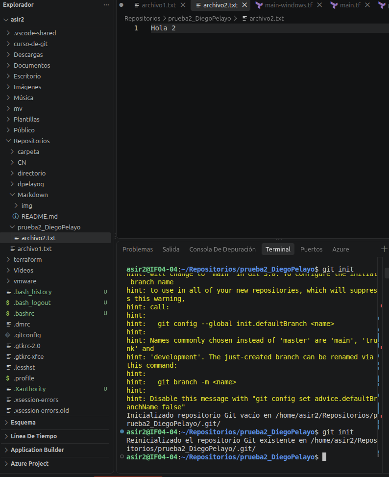
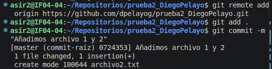
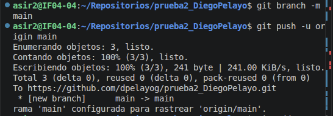
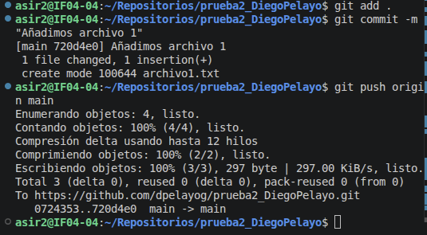
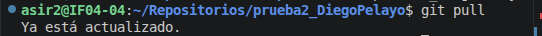
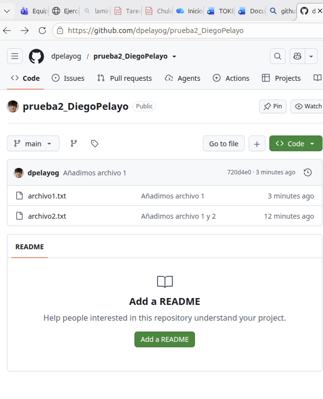
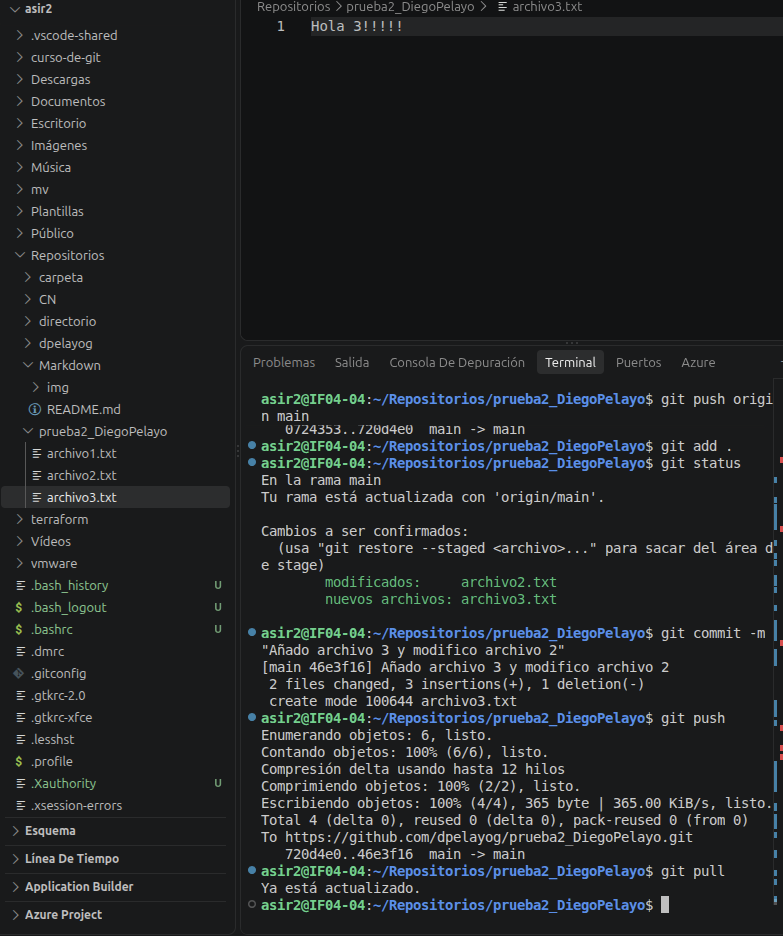

# EJERCICIO 1
## Diego Pelayo Gautier 
### ASIR2 Curso 26/27

Comenzamos haciendo el __git init__.

Conecto el repositorio con _github_, añado los archivos 2 y hago el __commit__.

creo la rama __main__ y subo a _github_ todo.

Añado el archivo 1, se hace el commit y se sube a github.

se hace un _git pull_ para extraer todo lo modificado en _github_, pero ya estaba actualizado.

demostracion _github_.

__Modificamos__ archivo 2 y añadimos archivo 3.

