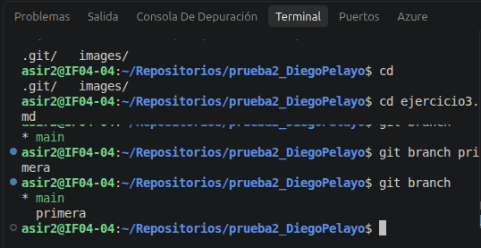
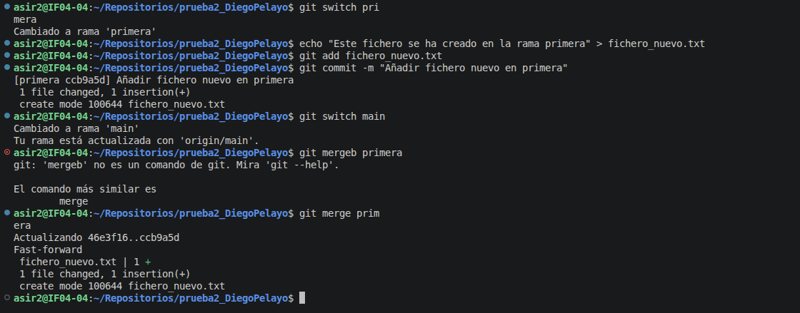
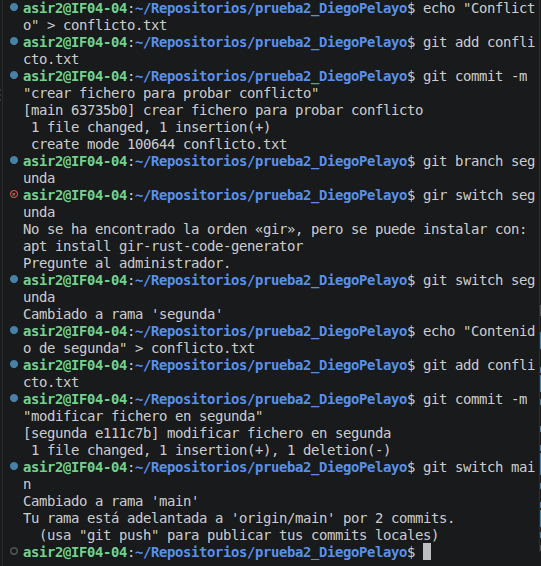
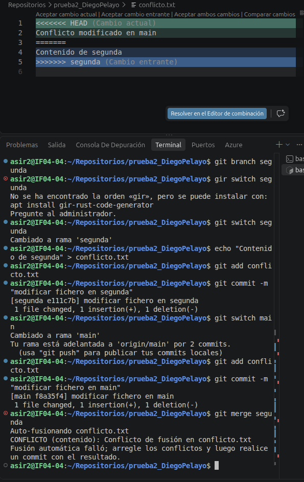
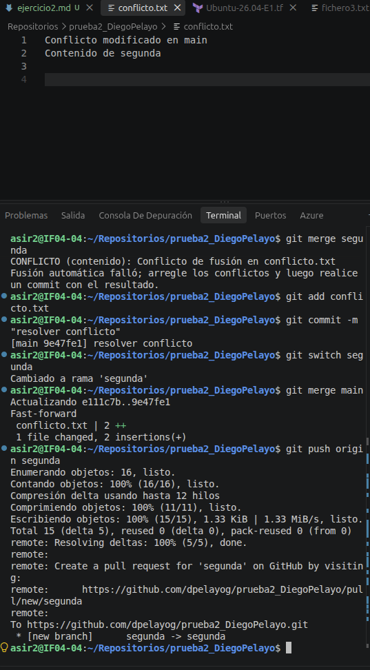
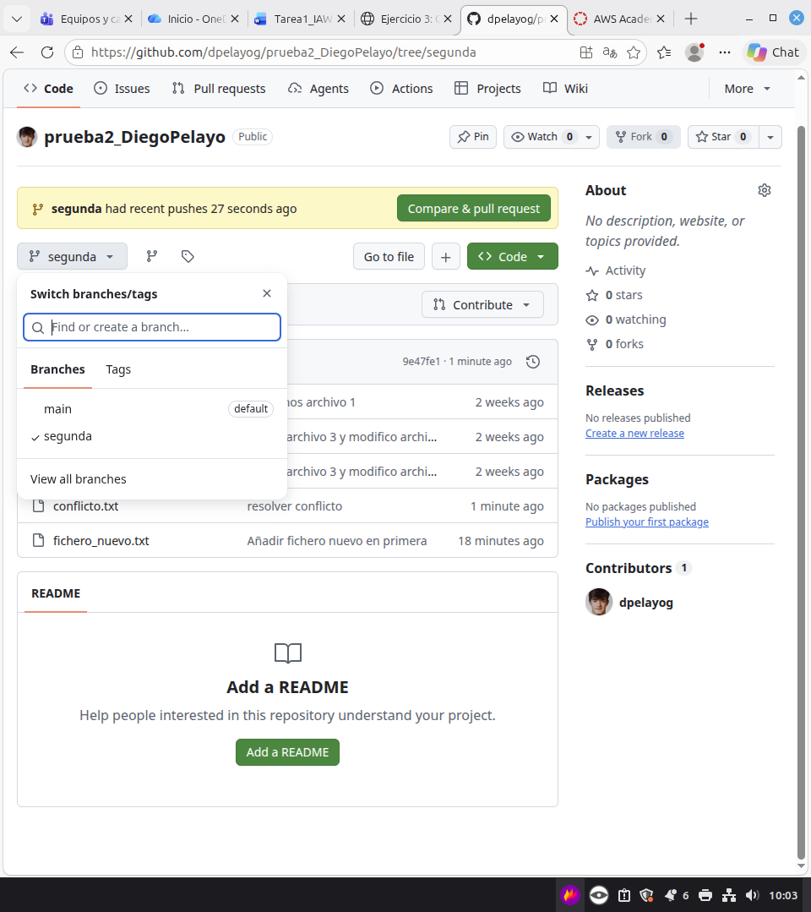

# EJERCICIO 3
## Diego Pelayo Gautier 
### ASIR2 Curso 26/27

Creamos la rama __primera__.
    
Cambiamos a primera, creamos un fichero, hago el commit, cambio a main y lo __combino__.
          
Creo un fichero llamado __conflicto__, hago el commit, creo segunda, me cambio a ella, creo otro archivo llamado conflicto pero con __distinto__ contenido, hago el commit y cambio al main.

                   
Aqui combinamos dos _conflicto.txt_ añadidos es distintas ramas con distinto contenido y vemos que da __conflicto__.

__Corregimos__ el conflicto, hacemos un commit del conflicto resuelto, lo vuelvo a combinar y se combina correctamente y lo subo a _github_.

Lo confirmo en el repositorio que esta todo __correcto__.

