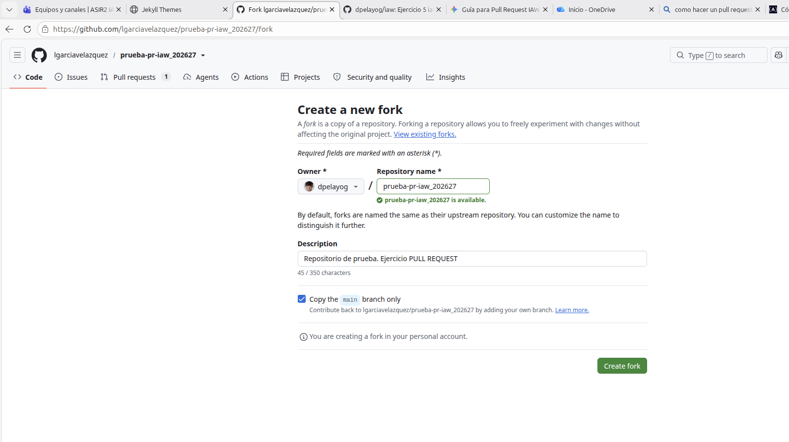
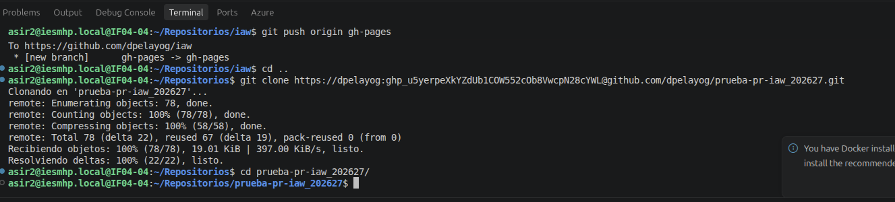
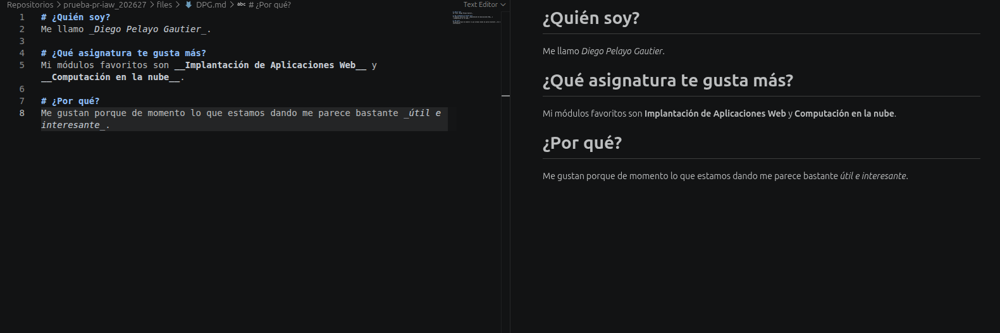
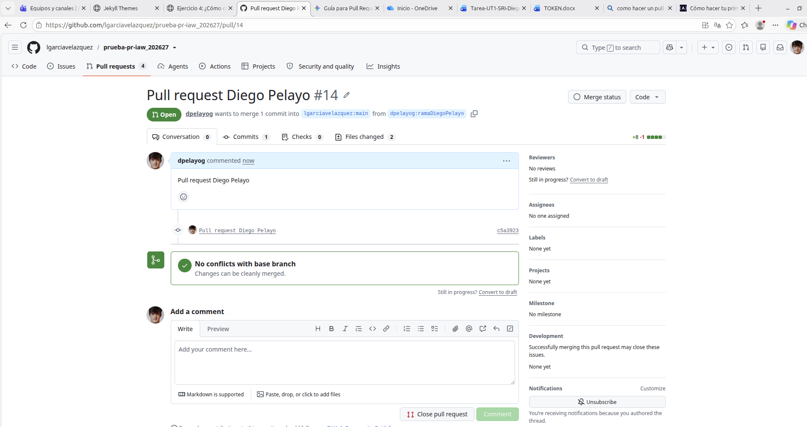

# EJERCICIO 4
## Diego Pelayo Gautier 
### ASIR2 Curso 26/27

Hacemos el __fork__ para copiar el repositorio

Hago el __git clone__

Modifico el _README_ y creo un _DPG.md_ respondiendo a las siguientes preguntas

Envio el __pull request__ a Luis

